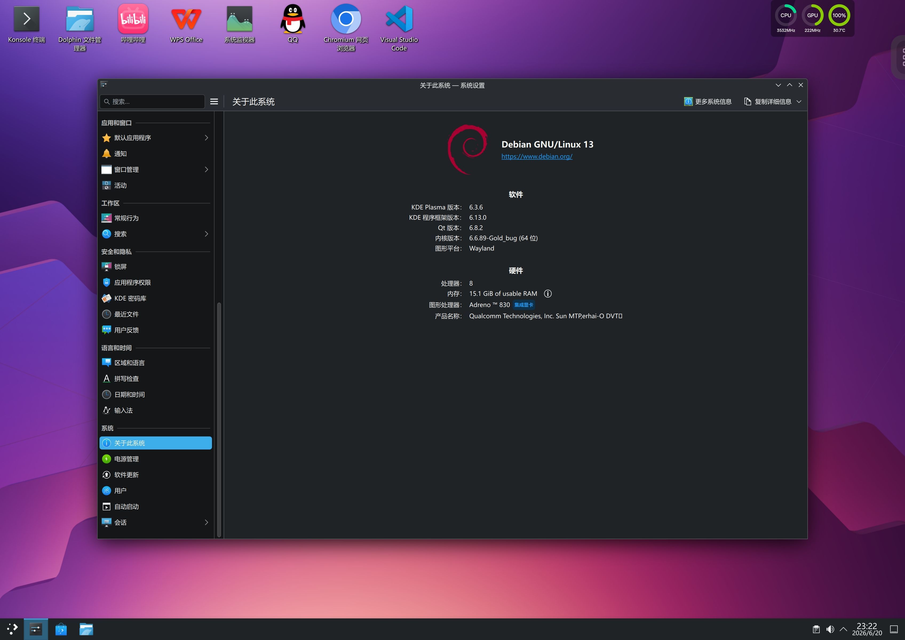

中文 | [English](README_english.md)

# Droidspaces RootFS 自动构建

通过 GitHub Actions 为 Android 上的 Droidspaces 构建 Debian、Ubuntu、Fedora 或 Arch Linux ARM64 RootFS。可选择 KDE、KDE Mobile、GNOME、Anland Next、Niri、Hyprland、Mango、Denial 或纯命令行环境，再下载 `.tar.xz` 导入 Droidspaces。

**快速开始：** Fork 仓库 → 打开 `Actions` → 运行“编译并发布 Droidspaces RootFS” → 从 `Releases` 下载 RootFS。

固定全桌面订阅源：在 Droidspaces 的 RootFS 仓库管理中添加 [中文 RootFS（GitHub）](https://github.com/Goldzxcbug/Droidspaces-rootfs-Desktop-builder/releases/download/droidspaces-rootfs-all-wayland/rootfs_zh.json)、[中文 RootFS（CNB）](https://cnb.cool/goldzxcbug/droidspaces-package/-/releases/download/droidspaces-rootfs-all-wayland/rootfs_zh.json) 或 [English RootFS（GitHub）](https://github.com/Goldzxcbug/Droidspaces-rootfs-Desktop-builder/releases/download/droidspaces-rootfs-all-wayland/rootfs_en.json)。

## GPU 版本

每个桌面镜像构建两个版本，按 GPU 厂商区分：

| 文件名带 | 适用 | 渲染方式 |
|---|---|---|
| `-qualcomm-` | 骁龙 / Adreno | Adreno 硬件加速（Mesa Turnip/Freedreno + kgsl）；不需要 `vkms`，也不需要 `mali_nsfix` |
| `-mediatek-` | 联发科 / Mali，自带标准 Wayland 合成器（KDE Plasma、KDE Plasma Mobile、GNOME、Hyprland、Niri、Mango、Denial） | 经 `ANLAND_DRM_DEVICE=/dev/dri/renderD128` 输出；Mali 没有 DRM render node，必须由 droidspaces-lkm 的 `vkms` 提供（llvmpipe 软件渲染） |

- **高通版**：Adreno 硬件加速，无需额外模块。
- **MTK 版**：宿主需加载 droidspaces-lkm 的 `vkms`（模块目录放 `enable_vkms`），否则合成器会因 `no usable DRM render device` 拒绝启动。
- **Anland Next（6.x waylandbridge，需要 `mali_nsfix`）不在本仓库构建**，请用 [droidspaces-anland6-rootfs](https://github.com/misaka5202/droidspaces-anland6-rootfs)。

一次构建两个版本：运行“发布全桌面 Wayland RootFS（高通 + MTK 双版本）”，
`gpu_vendor` 保持 `both`。只构建单个发行版的一个厂商版本，用单目标工作流并指定 `gpu_vendor`。

## 项目内容

- 七种发行版构建目标，支持 X11 与 Anland Wayland（依桌面和发行版而定）。
- 高通与 MTK 两个 GPU 版本，同一套源码构建。
- 可选中文环境、Fcitx5、音频转发、开发工具和 Docker。
- RootFS 自动发布到 GitHub Releases；容器内提供桌面会话、USB 管理与维护工具。

## 文档

- [文档目录与桌面截图](docs/zh/README.md)
- [从 Actions 构建并导入 Droidspaces](docs/zh/快速开始.md)
- [发行版兼容性与构建选项](docs/zh/构建选项.md)
- [桌面启动与 Anland Wayland 配置](docs/zh/桌面与Anland.md)
- [TUI、USB、固件与本地构建](docs/zh/进阶使用.md)
- [脚本维护说明](scripts/README.md)

## 支持范围

构建目标：`Debian-13`、`Ubuntu-26`、`Fedora-43`、`Fedora-44`、`Arch`。全部目标都通过 Anland Wayland 输出，完整兼容矩阵见[构建选项](docs/zh/构建选项.md)。

## 致谢

- [Droidspaces-OSS](https://github.com/ravindu644/Droidspaces-OSS/)：提供项目运行环境基础。
- [mesa-for-android-container](https://github.com/lfdevs/mesa-for-android-container)：提供 Snapdragon GPU 驱动支持。
- [droidspaces-media-decode](https://github.com/Re-s/droidspaces-media-decode)：提供 Android MediaCodec 容器硬件解码支持。
- [Anland](https://github.com/superturtlee/anland)：提供 Wayland 显示后端及相关工作。
- [Droidspaces USB Manager](https://github.com/Yizhou147/Droidspaces-USB-Manager)：提供 USB 存储和 ADB 设备管理工具。
---

[所有桌面截图](docs/zh/README.md#桌面截图) · [English README](README_english.md)

