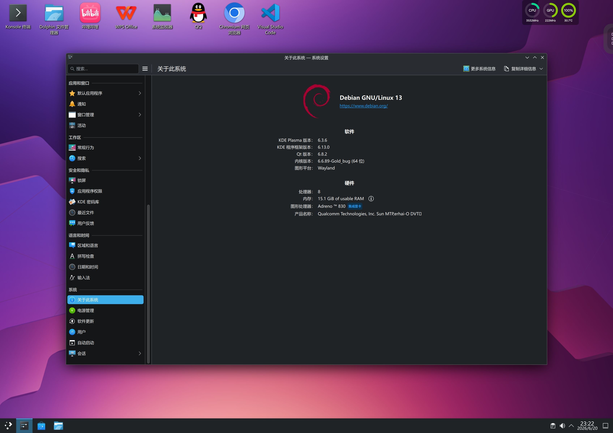

English | [中文](README.md)

# Droidspaces RootFS Builder

Build ARM64 Linux RootFS images for Droidspaces on Android with GitHub Actions. Choose Debian, Ubuntu, Fedora, or Arch Linux, select KDE, KDE Mobile, GNOME, Anland Next, Niri, Hyprland, Mango, Denial, or command-line mode, then import the generated `.tar.xz` archive into Droidspaces.

**Quick start:** Fork this repository → open `Actions` → run “Build and Release Droidspaces RootFS” → download the RootFS from `Releases`.

Subscribe to the rolling desktop feed in Droidspaces: [Chinese RootFS (GitHub)](https://github.com/Goldzxcbug/Droidspaces-rootfs-Desktop-builder/releases/download/droidspaces-rootfs-all-wayland/rootfs_zh.json), [Chinese RootFS (CNB)](https://cnb.cool/goldzxcbug/droidspaces-package/-/releases/download/droidspaces-rootfs-all-wayland/rootfs_zh.json), or [English RootFS (GitHub)](https://github.com/Goldzxcbug/Droidspaces-rootfs-Desktop-builder/releases/download/droidspaces-rootfs-all-wayland/rootfs_en.json).

## GPU variants

Every desktop image is built in two variants. **MediaTek images split into two
rendering routes by desktop** — check which one your image uses:

| Suffix | For | Rendering |
|---|---|---|
| `-qualcomm-` | Snapdragon / Adreno | Adreno hardware acceleration (Mesa Turnip/Freedreno over kgsl); neither route needs `vkms` |
| `-mediatek-` × Anland Next | MediaTek / Mali, Anland Next (6.x session) | libhybris drives the vendor Mali driver on `/dev/mali0`; host needs `mali_nsfix`, **no `vkms`** |
| `-mediatek-` × other desktops (KDE Plasma, KDE Plasma Mobile, GNOME, Hyprland, Niri, Mango, Denial) | MediaTek / Mali, ships its own standard Wayland compositor | The image renders via `ANLAND_DRM_DEVICE=/dev/dri/renderD128`; Mali has no DRM render node, so the host must supply one with droidspaces-lkm's `vkms` (llvmpipe software rendering). `mali_nsfix` does nothing for this route. |

- **Anland Next (6.x) × MediaTek**: install [droidspaces-lkm](https://github.com/misaka5202/droidspaces-lkm)
  on the host and load `mali_nsfix`. Without it the container cannot create a
  GPU context (`dmesg` shows `Failed to get pid pointer`; userspace sees
  `eglInitialize` return `0x3001`).
- **Other desktops × MediaTek**: load droidspaces-lkm's `vkms` on the host
  (`enable_vkms` in the module directory), otherwise the compositor refuses to
  start with `no usable DRM render device`.
- **Qualcomm**: both routes use Adreno hardware acceleration; nothing extra.

To build both variants at once, run **“发布全桌面 Wayland RootFS（高通 + MTK 双版本）”**
and leave `gpu_vendor` on `both`. To build a single distro for one vendor, use the
single-target workflow and set `gpu_vendor`.

## What it provides

- Seven distribution targets, with X11 and Anland Wayland support depending on the selected profile and distribution.
- Qualcomm and MediaTek GPU variants, built from the same source.
- Optional Chinese locale, Fcitx5, audio forwarding, development tools, and Docker.
- Automatic GitHub Release publishing, desktop session startup, USB management, and in-container maintenance tools.

## Documentation

- [Documentation index and desktop screenshots](docs/en/README.md)
- [Build with Actions and import into Droidspaces](docs/en/quick-start.md)
- [Supported distributions and build options](docs/en/build-options.md)
- [Desktop startup and Anland Wayland setup](docs/en/desktop-and-anland.md)
- [TUI, USB, firmware, and local builds](docs/en/advanced-usage.md)
- [Script maintenance guide](scripts/README_english.md)

## Targets

`Debian-13`, `Ubuntu-26`, `Fedora-43`, `Fedora-44`, and `Arch`. Every target outputs through Anland Wayland; see the [build options guide](docs/en/build-options.md) for the full compatibility matrix.

## Acknowledgements

- [Droidspaces-OSS](https://github.com/ravindu644/Droidspaces-OSS/): runtime foundation.
- [mesa-for-android-container](https://github.com/lfdevs/mesa-for-android-container): Snapdragon GPU driver support.
- [droidspaces-media-decode](https://github.com/Re-s/droidspaces-media-decode): Android MediaCodec hardware decoding for containers.
- [Anland](https://github.com/superturtlee/anland): Wayland display backend and related work.
- [Droidspaces USB Manager](https://github.com/Yizhou147/Droidspaces-USB-Manager): USB storage and ADB device management.
---

[All desktop screenshots](docs/en/README.md#screenshots) · [中文 README](README.md)

